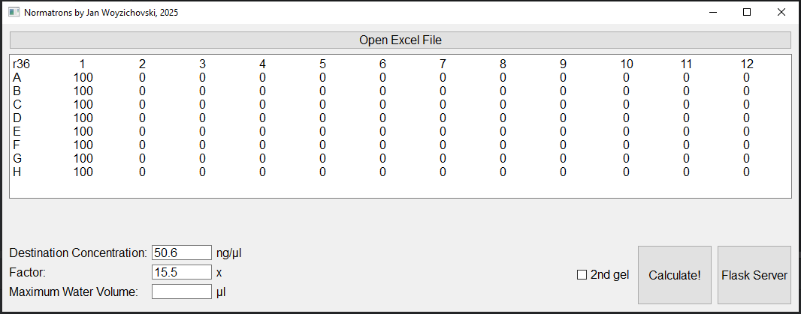
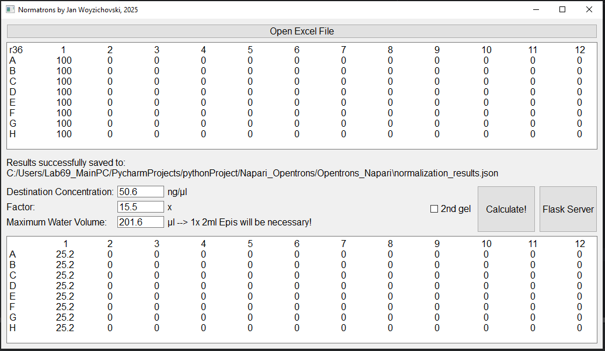
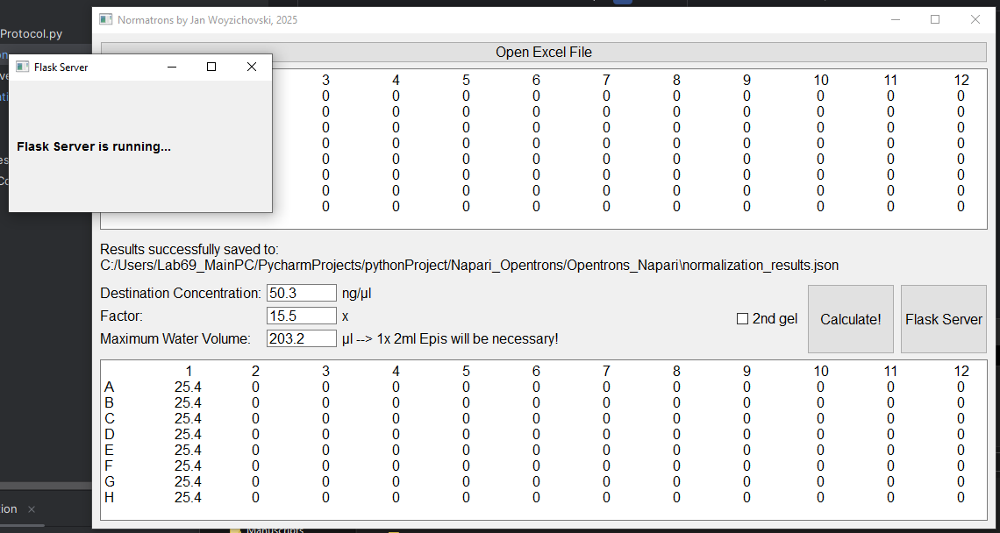

# Normatrons: <br/> DNA Normalization with the Opentrons OT-2

Normatrons is a Python-based workflow for calculating water additions from DNA concentration measurements and automating their dispensing with an Opentrons OT-2 liquid-handling robot. It combines an Excel-reading desktop application, JSON-based data exchange, and a robot protocol supporting one or two 96-position sample layouts.

The solution separates the **robot protocol** from the sample-specific data. Once the protocol has been configured for the laboratory setup, new plates with different concentration values can be processed without repeatedly generating and uploading a new protocol or deleting the previous one. Instead, the desktop application calculates and saves the updated water additions, which the robot retrieves directly from the desktop computer at the start of each run. Protocol changes are only needed when the liquid-handling procedure or hardware configuration changes, rather than for every new dataset.

<details>
    
<summary> Project information </summary>

| Field | Description |
|---|---|
| Author | Jan Woyzichovski |
| Repository | https://github.com/JanWoyzi/Opentrons_OT2_Normalization |
| Software name | Normatrons / Opentrons_OT2_Normalization |
| Research domain | Molecular biology and laboratory automation |
| Programming language | Python |
| Input formats | Excel `.xlsx` and `.xls` |
| Intermediate format | JSON |
| Robot platform | Opentrons OT-2 |
| Declared protocol API | Opentrons Python Protocol API 2.13 |
| Software license | MIT |

This documentation describes the inspected source code and intended workflow. It does not constitute laboratory validation or a verified compatibility statement.
</details>

## Overview

Normatrons connects DNA concentration measurements to an automated water-addition workflow using a desktop computer and an Opentrons OT-2.

The desktop computer runs the normalization application and the restricted results server. The OT-2 runs the liquid-handling protocol through its built-in Jupyter Notebook access point.

The workflow is:

1. Upload `Scripts/1x_Norm_Protocol.py` to the OT-2 through its built-in Jupyter environment.
2. Prepare a notebook to load and execute the protocol, and configure the connection to the desktop computer. Don't start it yet!
3. Import concentration measurements into the desktop application.
4. Enter the destination concentration and calculation factor.
5. Calculate and inspect the water additions.
6. Save the required one or two datasets to `normalization_results.json`.
7. Set the robot deck up with all neccessary equipment and liquids.
8. Start the results server on the desktop computer and leave it running.
9. Execute the prepared notebook on the OT-2 to start the protocol.
10. The protocol retrieves the saved results from the desktop computer and performs the water additions.

The software uses concentration measurements that have already been generated. It does not analyze gel images or measure DNA concentration.

The intended liquid-handling operation adds water directly to existing DNA samples. It does not transfer DNA into a separate destination plate.

## Repository structure

```text
Opentrons_OT2_Normalization/
├── LICENSE
├── README.md
├── requirements-desktop.txt
├── requirements-dev.txt
├── tests/
│   └── test_results_server.py
└── Scripts/
    ├── Normalization.py
    ├── Flask_server.py
    ├── results_server.py
    ├── results_client.py
    ├── 1x_Norm_Protocol.py
    └── config.json
```

| File | Purpose |
|---|---|
| `Normalization.py` | Desktop GUI for Excel import, volume calculation, results display, JSON export, saved preferences, and integrated server launch. |
| `results_server.py` | The single, restricted results server: one authenticated `/results` endpoint serving one administrator-configured file. |
| `Flask_server.py` | Standalone launcher; starts `results_server.py` (same behavior as the GUI button). |
| `results_client.py` | Robot-side client: authenticated download with timeout and controlled errors. Upload it to the OT-2 next to the protocol. |
| `1x_Norm_Protocol.py` | OT-2 protocol intended to retrieve calculated volumes and dispense water. |
| `config.json` | Saved GUI settings, including paths, calculation parameters, and window dimensions. |
| `LICENSE` | Software licensing terms. |

## Requirements

### Desktop software

The application uses:

- Python.
- `qtpy` and a compatible Qt binding, such as `PyQt5`.
- `pandas`.
- `Flask` and `cheroot` (production WSGI server, also on Windows).
- Optional: `cryptography`, to create a self-signed HTTPS certificate with `--make-cert`.
- `tabulate`.
- An appropriate Excel reader: `openpyxl` for typical `.xlsx` files or `xlrd` for legacy `.xls` files.

These requirements are inferred from the source. Tested Python and dependency versions should be recorded for each deployment.

### Robot software

The robot-side workflow requires:

- The Opentrons Python API.
- The `requests` package.
- Access to the required labware definitions.
- Network connectivity to the computer providing the results.

The protocol declares API level `2.13`. Confirm compatibility with the installed OT-2 software before use.

### Hardware

The configured workflow uses:

- An Opentrons OT-2.
- A P300 Single-Channel GEN2 pipette on the left mount.
- A P20 Single-Channel GEN2 pipette on the right mount.
- One Temperature Module GEN2 for the first dataset.
- A second Temperature Module GEN2 when processing two datasets.
- 20 µl and 200 µl filter-tip racks.
- A water-source tube block.
- Temperature-module-compatible sample labware.

## Installation

### Desktop computer

Clone the repository and create an isolated Python environment:

```bash
git clone https://github.com/JanWoyzi/Opentrons_OT2_Normalization.git  # Download the repository.
cd Opentrons_OT2_Normalization  # Enter the repository directory.
python -m venv .venv  # Create an isolated Python environment.
```

Activate the environment using the command appropriate for your operating system.

Install the desktop dependencies:

```bash
python -m pip install -r requirements-desktop.txt  # Install the desktop dependencies, Excel readers and the results server.
```

Launch the application:

```bash
cd Scripts  # Use the scripts directory so relative configuration paths resolve there.
python Normalization.py  # Start the desktop application.
```

These commands provide a proposed setup based on the source imports. They are not a tested environment specification.

Before first use, review or remove the supplied `config.json`, which contains computer-specific settings.

### OT-2 and Jupyter preparation

The robot protocol is prepared and executed using the OT-2’s built-in Jupyter Notebook access point.

1. Connect to the OT-2 and open its Jupyter environment.
2. Upload `Scripts/1x_Norm_Protocol.py` and `Scripts/results_client.py` to `/var/lib/jupyter/notebooks/` on the robot.
3. Create or open the notebook used to prepare and execute the protocol.
4. Create the robot's client settings file `normatrons_client.json` (see [Computer-to-robot communication](#computer-to-robot-communication)). The results-file location is configured only on the desktop computer.
5. Confirm that the notebook can access the uploaded protocol and that the required labware definitions are available.
6. Prepare the protocol-loading and execution cells, keeping robot execution separate from preparation.
7. Load the required labware, tips, water, and samples according to the deck layout.

The repository contains the Python protocol file; a ready-made execution notebook is not included in the documented repository structure.

Preparing or uploading the protocol does not start the normalization run. Execute the robot notebook only after the results have been saved, the results server is running, and the experimental setup has been checked.

## Input data

### Excel layout

The application reads the first worksheet. The first row supplies column headers, and the first data column is excluded from the calculation.

For the intended 96-position layout, prepare:

- Eight sample rows.
- Twelve numeric sample columns.
- One leading column for row labels or other information that should not be calculated.

Example structure:

| Row | 1 | 2 | … | 12 |
|---|---|---|---|---|
| A | Concentration | Concentration | … | Concentration |
| B | Concentration | Concentration | … | Concentration |
| C | Concentration | Concentration | … | Concentration |
| D | Concentration | Concentration | … | Concentration |
| E | Concentration | Concentration | … | Concentration |
| F | Concentration | Concentration | … | Concentration |
| G | Concentration | Concentration | … | Concentration |
| H | Concentration | Concentration | … | Concentration |

Use numeric values in the sample cells. Record units separately rather than adding unit strings to individual numeric cells.

The GUI labels the destination concentration in ng/µl; input concentrations should use compatible units.

### Sample-to-well mapping

Values are read down each sample column before moving to the next column:

```text
A1 → B1 → C1 → D1 → E1 → F1 → G1 → H1 → A2 → … → H12
```

Mapping follows worksheet position, not a lookup of sample identifiers. Confirm that the workbook order matches the physical sample arrangement.

Retain an independent sample-to-well map with the experimental record.

## Calculation

For each numeric measurement, the application implements:

```math
V_{\mathrm{water}} = \max\left(0, \left(\frac{C_{\mathrm{input}}}{C_{\mathrm{target}}} - 1\right)F + 10.1\right)
```

Positive results are rounded to one decimal place.

| Parameter | Meaning |
|---|---|
| `C_input` | Numeric concentration measurement from Excel. |
| `C_target` | Destination concentration entered in the GUI. |
| `F` | User-entered calculation factor. |
| `10.1` | Fixed additive offset in the implemented expression. |
| `V_water` | Result interpreted as a water addition in µl. |

This describes the implemented calculation, not a universal dilution equation.
Establish the experimental meaning and units of the factor and offset before
applying the workflow to another assay.

Record all calculation parameters with each experiment. Adding water cannot
increase the concentration of a sample below its target.

## Desktop workflow and robot execution

### 1. Calculate the first dataset

On the desktop computer:



1. Open `Normalization.py`.
2. Select “Open Excel File”.
3. Inspect the imported worksheet.
4. Confirm concentration units and sample order.
5. Enter the destination concentration and factor.
6. Leave “2nd gel” unchecked for the first dataset.
7. Select “Calculate!”.
8. Choose an output directory if prompted.
9. Inspect the displayed water additions and exported `normalization_results.json`.



### 2. Add a second dataset, if required

Before starting the robot:

1. Load the second Excel workbook.
2. Select “2nd gel”.
3. Calculate and save the results.
4. Confirm that the output contains both intended datasets in the correct order.

With “2nd gel” unchecked, saving replaces the output with the current dataset. With it checked, the normal one-/two-dataset workflow retains the first dataset and appends or replaces the second.

### 3. Start the results server on the desktop computer

After saving and checking all datasets:

1. Select “Flask Server” in the desktop application to launch the results server.
2. Check the server window: it shows the URL the robot must use, or why the server did not start. It warns if the configured results file differs from the GUI's save location.
3. Leave the server window running.

Start the server before executing the robot notebook: the protocol needs it to retrieve the results at the beginning of the run.

Use only one server-launch method. `python Flask_server.py` starts the identical server without the GUI; stop it with Ctrl+C. (The old 10-second auto-shutdown timer was removed.)



### 4. Start the protocol from the robot notebook

With the results saved and the desktop results server running:

1. Return to the prepared notebook in the OT-2’s Jupyter environment.
2. Confirm the selected protocol, connection settings, dataset order, and physical deck arrangement.
3. Execute the notebook cells that start the protocol.
4. Monitor retrieval of the results and the subsequent robot execution.

Do not change or overwrite the results file between the final check and retrieval by the robot.

### Execution order at a glance

```text
Prepare the protocol and notebook on the OT-2
                    ↓
Calculate and save all datasets on the desktop
                    ↓
Start the desktop results server
                    ↓
Execute the prepared notebook on the OT-2
                    ↓
Retrieve results and perform water additions
```

### Water requirement display

The field labeled “Maximum Water Volume” displays the sum of water additions for the current calculation.

The tube estimate assumes 1,800 µl of usable water per 2 ml source tube. This conservative threshold leaves a nominal 200 µl reserve in a tube filled to 2 ml, providing a safety margin to reduce the risk of running low or aspirating from an empty tube during the run.

Independently verify the total water requirement and fill the source tubes accordingly before starting the robot, accounting for both datasets where applicable.

## Output data

The application writes:

```text
normalization_results.json
```

The outer JSON array contains one or two datasets. Each complete dataset contains 96 water-addition volumes in the documented well order.

| Property | Convention |
|---|---|
| Format | JSON |
| Outer structure | Array of datasets |
| Intended dataset length | 96 entries |
| Volume unit | µl |
| Dataset order | First dataset, then optional second dataset |
| Precision | Positive calculated additions rounded to one decimal place |

Abbreviated structural illustration—not a complete or valid robot-input example:

```text
[
  [volume_A1, volume_B1, ..., volume_H12],
  [volume_A1, volume_B1, ..., volume_H12]
]
```

The current output does not embed sample identifiers, units, workbook provenance, calculation parameters, or software version. Preserve those separately alongside the JSON.

## Computer-to-robot communication

The desktop computer serves exactly one file — the administrator-configured `normalization_results.json` — on one fixed endpoint, `GET /results`. The robot cannot choose a file name or path. Every request must carry a secret token in the header `Authorization: Bearer <token>`.

| Request | Response |
|---|---|
| No or wrong token | `401 {"error": "Unauthorized"}` — the results file is not touched. |
| Correct token | `200 {"content": "<text of the results file>"}` |
| Results file missing | `503 {"error": "Results unavailable"}` |
| Results file not valid JSON, unreadable, or larger than 1 MB | `500 {"error": "Results unavailable"}` |
| Any other URL, including the old `/read_file/...` | `404 {"error": "Not found"}` |

Error messages never contain file paths, exception text, or secrets. Every response carries `Cache-Control: no-store`. Both launch paths (GUI button and `Flask_server.py`) use the same code in `results_server.py`, served by the production server `cheroot` with Flask debugging disabled.

### One-time setup on the desktop computer

Run these commands in the `Scripts` folder. The settings file and certificate are stored in your user folder, outside the repository (`~/.normatrons/`; on Windows `C:/Users/<you>/.normatrons/`). Set the environment variable `NORMATRONS_SERVER_CONFIG` to use a different location.

```bash
python results_server.py --init --results-file "C:/path/to/Results/normalization_results.json" --host 169.254.52.10  # Create settings with a new random token; prints the token once.
python results_server.py --make-cert --host 169.254.52.10  # Optional but recommended: create a self-signed HTTPS certificate for this IP.
```

- `--host` is the IP address of the desktop computer's network card that is connected to the robot (Windows: `ipconfig`). The server refuses to listen on `0.0.0.0`.
- `--results-file` must be the file the GUI saves (output directory + `normalization_results.json`).
- To create a new token later, run `--init` again and update the robot. Never commit the settings file, token, or `normatrons_key.pem`.

### HTTPS and plain HTTP

With a certificate configured, traffic is encrypted and the robot verifies the desktop computer's identity. Without a certificate the server only starts if you set `"allow_plain_http": true` in the settings file. **Over plain HTTP the bearer token and the results are sent unencrypted** and can be read by anyone on the same network. Use plain HTTP only on a direct, private cable between the computer and the robot; on shared networks use HTTPS or an encrypted tunnel (for example an SSH tunnel).

### Firewall: allow only the robot

Allow inbound connections to the port only from the robot's IP address. Windows (PowerShell as administrator):

```powershell
New-NetFirewallRule -DisplayName "Normatrons results (robot only)" -Direction Inbound -Protocol TCP -LocalPort 5000 -RemoteAddress 169.254.52.20 -Action Allow  # Allow only the robot's IP to reach port 5000.
```

If Windows previously asked "Allow Python to communicate on networks" and you agreed, it created a broad rule for `python.exe`. Remove or restrict that rule in "Windows Defender Firewall with Advanced Security" → "Inbound Rules". Do not expose the server to the public internet.

### Robot client settings

Copy `normatrons_cert.pem` (the certificate, never the key) to the robot and create `/var/lib/jupyter/notebooks/normatrons_client.json` through Jupyter:

```json
{
  "url": "https://169.254.52.10:5000/results",
  "token": "<token printed by --init>",
  "ca_cert": "/var/lib/jupyter/notebooks/normatrons_cert.pem",
  "timeout_seconds": 10
}
```

For plain HTTP use an `http://` URL, omit `ca_cert`, and add `"allow_plain_http": true`. If the settings are missing or the server is unreachable, rejects the token, or returns an error, the protocol stops with `ResultsFetchError` before any labware is loaded or liquid is moved.

### Tests

```bash
python -m pip install -r requirements-dev.txt  # Install test dependencies.
python -m pytest -v  # Run the server, GUI-launch, client and abort tests (Linux: set QT_QPA_PLATFORM=offscreen).
```

## OT-2 configuration

### Deck layout

| Slot | Equipment |
|---|---|
| 3 | First Temperature Module GEN2 and sample labware |
| 4 | Water-source tube block |
| 6 | Optional second Temperature Module GEN2 and sample labware |
| 7 | Additional 200 µl filter-tip rack for two-dataset operation |
| 8 | Additional 20 µl filter-tip rack for two-dataset operation |
| 10 | First 200 µl filter-tip rack |
| 11 | First 20 µl filter-tip rack |

### Labware identifiers

```text
opentrons_96_filtertiprack_200ul
opentrons_96_filtertiprack_20ul
sarstedtsafeseal_24_aluminumblock_2000ul
nest0.2mlpcr8striptubes_96_aluminumblock_200ul
```

Confirm that the definitions are available and correspond to the physical equipment.

### Intended liquid-handling behavior

The protocol is intended to:

- Maintain sample modules at 4 °C during dispensing.
- Skip additions of 0.5 µl or less.
- Use the P20 for additions above 0.5 µl through 20 µl.
- Use the P300 for additions above 20 µl.
- Use a fresh P20 tip per destination.
- Reuse a P300 tip across larger additions.
- Advance through water-source tubes using a cumulative-volume counter.

Review these choices against the assay’s contamination requirements, pipetting limits, sample volumes, and labware geometry.

This description does not establish that the checked-in protocol is operational or experimentally validated. Simulate the intended configuration and perform a water-only trial before processing samples.

## Reproducibility and provenance

For each experiment, retain:

| Category | Information to preserve |
|---|---|
| Measurements | Original workbook, measurement method, instrument, units, and relevant calibration. |
| Sample identity | Sample-to-well mapping and dataset order. |
| Calculation | Target concentration, factor, and applicable calculation assumptions. |
| Robot input | The exact JSON supplied to the robot. |
| Software | Git commit or release, Python version, dependency versions, and robot-software/API versions. |
| Hardware | Pipettes, tips, labware definitions, offsets, starting volumes, and deck arrangement. |
| Execution | Date, operator, simulation output, robot logs, and manual deviations. |

Store these records under a shared experiment identifier.

Apply appropriate access controls to sensitive sample information. The software license does not automatically determine reuse permissions for experimental data.

## Citation

Until an archival software citation is available, use this template:

> Woyzichovski, Jan. Normatrons: Opentrons_OT2_Normalization. GitHub repository. Version or commit: [exact release or commit]. https://github.com/JanWoyzi/Opentrons_OT2_Normalization. Accessed [YYYY-MM-DD].

Replace the bracketed fields with the version and access date actually used.

For a research release:

- Add a `CITATION.cff` file containing verified author and software metadata.
- Create a versioned release.
- Archive that release with a service providing a persistent identifier.
- Update the citation with the resulting identifier.

Do not substitute a repository URL or commit hash for an archival DOI.

## FAIR-oriented research software

This documentation supports discovery, access, interoperability, and reuse. It does not claim that the repository already satisfies every FAIR4RS requirement.

| Principle | Information provided | Further publication work |
|---|---|---|
| Findable | Name, author, repository, domain, keywords, and citation guidance. | Machine-readable citation metadata, persistent identifier, versioned releases, and indexing. |
| Accessible | Repository location, installation instructions, and deployment requirements. | Long-term archived software and metadata, with documented access conditions. |
| Interoperable | File formats, units, well order, dependencies, and hardware interfaces. | Versioned schemas, dependency specifications, and required labware definitions. |
| Reusable | License, workflow, parameter descriptions, provenance guidance, and version identification. | Tested environments, example inputs and outputs, and validation evidence. |

## Support and contributions

Use the repository’s GitHub Issues section for questions and proposed improvements.

When reporting behavior, include:

- The relevant commit or release.
- Operating system and dependency versions.
- Robot-software/API versions where applicable.
- A minimal anonymized input example.
- Expected and observed behavior.

Do not publish credentials or confidential sample information.

Contributions should document changes to calculation assumptions, file formats, sample ordering, hardware configuration, and dependencies.

## License

This software is distributed under the MIT License.

Copyright © 2026 JanWoyzi.

See `LICENSE` for the full terms, including attribution requirements and warranty provisions.
